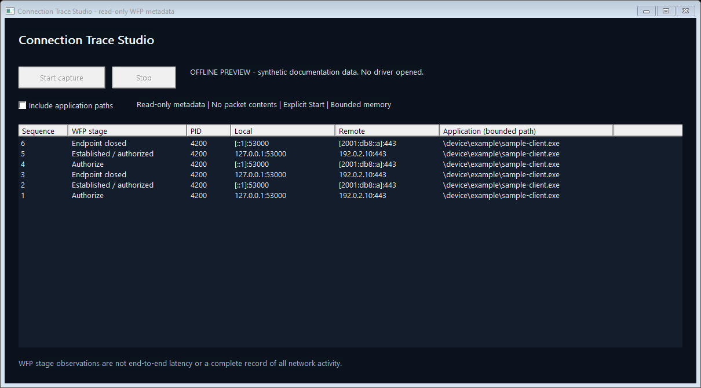

# Connection Trace Studio

**Read-only Windows connection lifecycle diagnostics with a native C++ SDK and a WFP kernel sensor.**

Inspect the application, process, local/remote address and port, and observed
Windows Filtering Platform stage behind a connection. Designed as a compact
integration example for desktop diagnostics, OEM software and support tooling.



**Engineering preview:** the new sensor requires Microsoft signing and coordinated
runtime validation. The source builds and offline tests do not establish that a
signed driver has been tested on a real network. No WHQL, Windows Server or
Windows certification claim is made. Targets Windows 10 2004+ / Windows 11 x64.

## Install and use

1. Download the complete release archive when a signed package is available.
2. Run `ConnectionTraceSetup.exe` and choose **Install / reinstall**, or run
   `ConnectionTraceSetupConsole.exe /install` from an administrator console.
   The installers refuse an unsigned or untrusted driver catalog. Restart only
   if Windows requests it; no restart or capture starts automatically.
3. Run `ConnectionTraceStudio.exe` as administrator and choose **Start capture**.
   Application paths are off by default; select **Include application paths**
   before starting only when you need that sensitive metadata.
   The application opens inactive. Generate ordinary network activity with your
   own applications to observe events. **Stop** or closing the app removes only
   its dynamic WFP filters and disables capture.
4. To remove it, use **Uninstall** or `ConnectionTraceSetupConsole.exe /uninstall`.

One active sensor client is allowed. `ConnectionTraceStudio.exe --preview`
shows synthetic documentation data without opening the driver or WFP engine.
Building the installer source without an opaque driver payload produces a
source-development executable that cannot install a driver.

For console output:

```text
ConnectionTraceCLI.exe --capture 30
ConnectionTraceCLI.exe --capture 30 --include-paths
```

This performs a 30-second explicit local capture. Ctrl+C stops it. Redirect
console output if needed; the application does not upload or automatically save
anything. Administrator access is needed for the sensor and WFP session, not to
edit or build the open-source application.

`--capture-json 30 C:\Reports\new.json` explicitly creates a structured report
and a `.ready` marker after capture starts. Existing files are never overwritten.
It records numeric stage/endpoint/port/PID metadata and path lengths, rather
than exporting application paths. `--session-self-test C:\Reports\new.json`
checks a real installed sensor's Start/Stop cycles with paths off/on/off; it is
separate from the offline build tests.

## What is observed

| Stage | Meaning |
|---|---|
| Authorize / Reauthorize | ALE outbound connection authorization, including separately marked policy reauthorization |
| Established / authorized | TCP established notification, or non-TCP traffic authorization; not proof of an application protocol handshake |
| Endpoint closed | Socket/endpoint lifetime notification; may include endpoints with no observed outbound start |

Both IPv4 and IPv6 layers are registered. IPv4-mapped dual-stack sockets can
appear at the IPv6 layer. PID, endpoint identifier, protocol and addresses have
availability flags. Optional paths are bounded to 127 UTF-16 code units with a truncation
flag. Endpoint identifiers are pseudonymized separately for each capture; they
are temporary correlation identifiers, not pointers or permanent
machine or process identities. PID reuse, UDP multiple peers, missing events and
reauthorization mean a row is not automatically a distinct successful TCP connection.

Timestamps use the kernel performance counter. Intervals between observed stages
are WFP stage intervals, **not end-to-end latency**, packet RTT, DNS timing or a
guaranteed account of why another firewall permitted or blocked a connection.
Higher-priority filters can prevent an inspection callback. Capture starts after
Start; existing connections can lack initial events. The kernel ring is bounded
to 2,048 events and the UI shows the latest 500 rows. Drop counters expose overload;
this is not a complete packet capture or an EDR/security enforcement product.

The driver never waits for a user-mode decision, reads packet contents, decrypts
TLS, modifies traffic or grants caller-supplied code access to the kernel. It
does not replace Windows Firewall. A 20 ms user-mode polling interval controls
display/consumer updates; it does not delay or pend a connection.

## Minimal C++ integration

Compile `SDK/ConnectionTrace.cpp` with your application and include its header.
Link `setupapi`, `fwpuclnt`, `ws2_32` and `rpcrt4`. All operations are single-thread
owned; use one Session on one thread.

```cpp
ConnectionTrace::Session capture;
capture.Start();
for (const auto& event : capture.Read()) {
    std::wcout << event.ProcessId << L" -> "
               << ConnectionTrace::Address(event, true) << L'\n';
}
// Scope exit stops capture and removes this session's dynamic WFP objects.
```

`Start(true)` opts in to application paths; `Start()` omits them at the driver.
`Read()` is nonblocking and returns at most 64 decoded, validated event records.
Call it repeatedly in your event loop; see [Examples/capture.cpp](Examples/capture.cpp).
`Status()` exposes the counter frequency, produced/dropped counts and ring depth.
`Correlator` is a bounded best-effort endpoint helper, with missing-start and
eviction information; it must not be treated as a lossless activity log.

## Build and validation

Visual Studio 2022 Desktop C++ tools, CMake 3.20+, Windows SDK, x64:

```powershell
.\Build.ps1
.\Build.ps1 -Asan
# Optional: build one-file installers with an opaque signed package.
.\Build.ps1 -DriverPackageDirectory C:\Signed\ConnectionTrace
```

Outputs: `obj/Build/Release`. Tests validate malformed protocol data, bounded
correlation under stress and package trust rejection without installing a driver,
creating WFP filters or capturing live traffic. See [validation status](docs/VALIDATION.md).
Kernel implementation and submission assets are private and are not in this repo.

## Licensing and integration

Application, two-file SDK, examples and installer source: [MIT](LICENSE). The
separate driver binary is provided for evaluation under its included binary terms;
this preview has **no technical trial timer or activation system**. For production
redistribution, OEM integration or support, add **`titancsa` on Discord**.

Use only on systems you own or are authorized to administer. Address, process and
application metadata can be sensitive even without packet contents. The project
is intended for lawful diagnostics and development. You are responsible for your
use; software is provided as described in its license, subject to applicable law.

Technical references: [Microsoft WFP callout considerations](https://learn.microsoft.com/en-us/windows-hardware/drivers/network/callout-driver-programming-considerations),
[dynamic WFP object lifetime](https://learn.microsoft.com/en-us/windows/win32/fwp/object-management),
[ALE endpoint lifetime](https://learn.microsoft.com/en-us/windows-hardware/drivers/network/ale-endpoint-lifetime-management).
Built-in per-app permit/block policies can be configured from user mode without a
new kernel driver; this sensor focuses on its bounded metadata integration interface.
